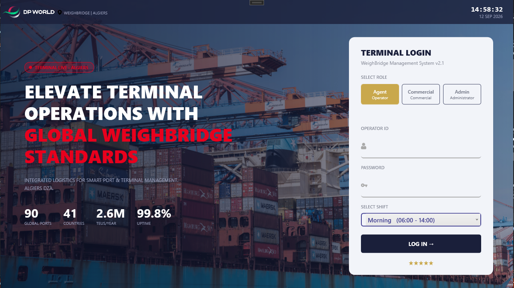
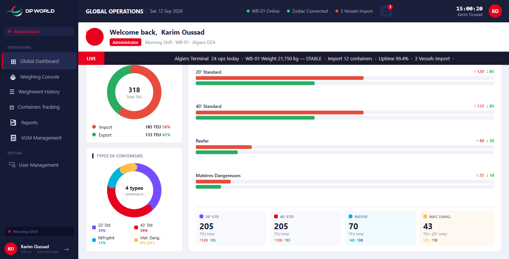
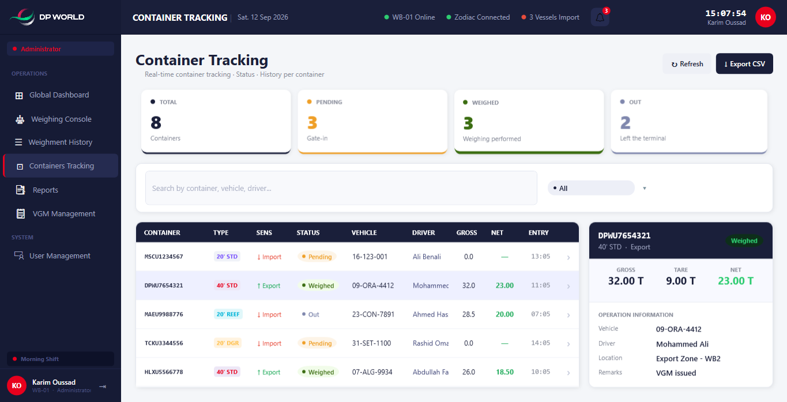

# WeighBridge — Terminal Weighbridge Management System (Desktop Client)

> 🎓 PFE (Projet de Fin d'Études) — Bachelor’s Final-Year Project
> This repository contains **the frontend/desktop client** I built as my individual contribution to a team project.

---

## 📌 About This Repository

This is **not the complete final system** — it's my personal contribution to a team PFE project: a full **WPF desktop client** for managing weighbridge operations at a container terminal (checking trucks in/out, weighing containers, issuing VGM certificates, tracking shipments, and generating reports).

The rest of the system — the **backend/API + database** and the **real hardware integration** (weighbridge scale readings, the Zodiac weight-indicator device) — was developed separately by teammates. This client was built against clean service interfaces so it can be connected to a real backend without changing any of the UI or ViewModel code.


---

## ✨ What's Implemented in This Repo

- **Role-based login** (Agent / Commercial / Admin) with per-role dashboard access
- **Global Dashboard** — live KPI cards, import/export donut charts, container-type bar charts, a scrolling live ticker
- **Weighing Console** — single-weighment mode and a dual-20ft container mode (two containers weighed on one truck trip), with container authorization checks and printable ticket previews
- **Container Tracking** — real-time status board (Pending / Weighed / Out) with search & filtering
- **Weighment History** — searchable/filterable log of past weighments
- **VGM Management** — Verified Gross Mass certificate tracking
- **Reports & Analytics** — shift summaries, completion/status breakdowns, per-record ticket printing
- **Data Exports** — configurable CSV/Excel/PDF export options with column selection
- **User Management** — create/edit/deactivate operator accounts
- **Notifications** — categorized alerts (abnormal weight, unauthorized container, expired VGM)

## 🚧 What's Outside This Repo (Team Scope)

- **Backend/API + persistent database** — this client currently runs on in-memory mock/sample data seeded directly in the ViewModels
- **Real hardware integration** — the weighbridge scale and Zodiac indicator are simulated; the app depends on `IWeighmentRepository`, `IZodiacService`, and `ITOSRepository` interfaces so a teammate's real implementation can be swapped in without touching the frontend

---

## 🛠️ Tech Stack

- **C# / WPF** (.NET) — desktop UI
- **MVVM architecture** — custom `BaseViewModel` (`INotifyPropertyChanged`) + `RelayCommand`, no external MVVM framework
- **Dependency Injection** — `Microsoft.Extensions.DependencyInjection`

## 🏗️ Architecture

```
WeighBridge/
├── Models/              # Domain/data models (UserModel, VGMModel, WeighmentModel, ...)
├── Repository/          # Data-access interfaces (implementation lives outside this repo)
├── Services/            # Service interfaces (e.g. Zodiac scale service)
├── ViewModels/
│   ├── Base/            # BaseViewModel, RelayCommand
│   └── ...              # One ViewModel per screen (Dashboard, Console, Reports, ...)
├── Views/
│   ├── Windows/         # LoginWindow, MainWindow, TicketPreviewWindow
│   └── UserControls/    # One UserControl per screen, hosted inside MainWindow
├── Themes/               # Shared XAML styles, colors, converters
└── Helpers/              # Value converters, shared utilities
```

Navigation works through a single `MainViewModel`, which caches one ViewModel+View pair per page the first time it's visited and swaps the active page based on the signed-in user's role (Agent / Commercial / Admin each see a different sidebar).

---

## 🖼️ Screenshots

### Login


### Dashboard


### Weighing Console


### Container Tracking


---

## 🚀 Getting Started

### Prerequisites
- Visual Studio 2026 or later, with the **.NET desktop development** workload installed
- .NET SDK matching the version targeted in the `.csproj`

### Run it
1. Clone the repo:
   ```bash
   git clone https://github.com/mouradaissanii/WeighBridge.git
   ```
2. Open the solution (`.sln`) in Visual Studio
3. Restore NuGet packages (usually automatic on build)
4. Set `WeighBridge` as the startup project
5. Press **F5** to build and run

### 🔑 Demo Login Credentials

You must select the matching **role button** before logging in — credentials are locked to a specific role:

| Role       | Operator ID  | Password        |
|------------|--------------|-----------------|
| Agent      | `operator`   | `operator123`   |
| Commercial | `commercial` | `commercial123` |
| Admin      | `admin`      | `admin123`      |

---
